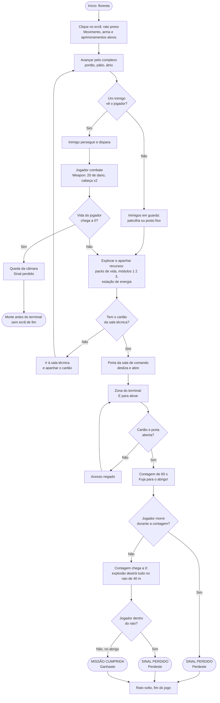

# ANJOCA Protocol: funcionalidades implementadas e fluxograma do jogo

Unity 6 (HDRP) · estado a 14/10/2026

Este documento reúne o que já funciona no protótipo, com base nos scripts da pasta `scripts/`, nas explicações da pasta `explicacoes/` e nas conversas do projeto. No fim está o fluxograma do jogo, do início até à vitória ou à derrota, e uma lista curta do que ainda falta.

---

## 1. Resumo por protótipo

| Protótipo | Funcionalidade | Scripts principais |
| --- | --- | --- |
| 1.º | Vida humana e energia do Fato, aprimoramentos 1 · 2 · 3, packs, módulos e estação de energia | `PlayerStats`, `SuitAbilities`, `Pickup`, `EnergyStation`, `DebugHUD` |
| 2.º | Movimento FPS (andar, correr, saltar, olhar) | `PlayerMovement` |
| 3.º | Inimigos: patrulha, perseguição, disparo, guardas fixos, drones, zonas de alerta | `Enemy`, `EnemyDrone`, `ZonaAlerta` |
| 4.º | Disparo do jogador e dano aos inimigos | `Weapon` |
| 5.º | Cartão de acesso e portas da sala de comando | `InventarioPlayer`, `CartaoAcesso`, `PortaComando` |
| 6.º | Terminal de autodestruição, contagem, explosão, abrigo e finais | `TerminalAutodestruicao` |
| Extras | Queda do jogador ao morrer, bloquear o rato, modo de teste, limites do mapa, tiros através de triggers | `PlayerQueda`, `BloquearCursor`, `ModoTeste` |

---

## 2. Jogador

### 2.1 Movimento (`PlayerMovement`)

| Tecla | Ação | Valor |
| --- | --- | --- |
| W A S D | Andar | 5 m/s |
| Shift | Correr | 8 m/s |
| Espaço | Saltar | 1,5 m (3 m com o Salto reforçado) |
| Rato | Olhar (corpo roda para os lados, câmara sobe e desce até 85°) | |

Usa o `CharacterController` com gravidade (-20) e o Input System novo.

### 2.2 Vida humana e energia do Fato (`PlayerStats`)

| | Vida humana | Energia do Fato |
| --- | --- | --- |
| Máximo | 100 | 100 |
| Como desce | Tiros dos inimigos, explosão do terminal, teclas de teste | Aprimoramentos ligados, laser do drone (tecla de teste L) |
| Como sobe | Só com packs de vida (+30) | Sozinha até 30 (2/s, depois de 3 s sem gastar); até 100 na estação de energia |
| A 0 | O jogador morre | Os aprimoramentos desligam-se, **não mata** |

- Há uma única função de dano, `TakeDamage()`, usada pelos inimigos, pelo drone, pela explosão e pelas teclas de teste. Aplica a Blindagem, não deixa a vida descer abaixo de 0 e marca `isDead`.
- Ao morrer: escreve "Sinal perdido", chama a queda (`PlayerQueda`), avisa o terminal de autodestruição, solta o rato e destrói o Player 1 s depois.

### 2.3 Aprimoramentos do Fato (`SuitAbilities`)

| Tecla | Aprimoramento | Efeito | Gasto |
| --- | --- | --- | --- |
| 1 | Salto reforçado | Salto de 3 m | 3 de energia/s |
| 2 | Blindagem | Recebe metade do dano | 5 de energia/s |
| 3 | Precisão | Liga/desliga e gasta energia (ainda não mexe na arma) | 4 de energia/s |

- Cada tecla liga e desliga. Vários ligados ao mesmo tempo somam o gasto.
- Só liga se o módulo já tiver sido apanhado e houver pelo menos 10 de energia.
- Sem energia, desliga tudo. Ao morrer, também.

### 2.4 Objetos para apanhar

| Objeto | Script | Efeito |
| --- | --- | --- |
| Pack de vida | `Pickup` (HealthPack) | +30 de vida; se a vida estiver cheia, fica no mapa |
| Módulo de Salto / Blindagem / Precisão | `Pickup` (JumpModule, ArmorModule, PrecisionModule) | Desbloqueia o aprimoramento correspondente |
| Estação de energia | `EnergyStation` | Enche a energia (25/s) enquanto o jogador está dentro do trigger |
| Cartão de acesso | `CartaoAcesso` | Passa a `temCartao = true` no `InventarioPlayer` |

Todos funcionam por trigger: basta o jogador passar por cima ou entrar na zona.

### 2.5 Disparo (`Weapon`)

- O raio sai do centro do ecrã (onde está a mira), com alcance de 100 m.
- Um tiro por clique (semiautomática). A linha do tiro (Line Renderer) aparece do cano até ao ponto atingido.
- Dano 20 por tiro; collider com a Tag `Head` faz o dobro.
- Tira vida aos soldados (`enemyHitDamage`) e aos drones (`enemyDroneHitDamage`), mesmo que o collider atingido seja um filho.
- Ignora caixas trigger. As caixas trigger invisíveis (portas, `ZonaAlerta`, `Terminal_Zona`, `Estacao_Energia`) estão na layer **Ignore Raycast**, para não travarem balas ([Ignore_Raycast_Triggers.md](../explicacoes/Ignore_Raycast_Triggers.md)).

### 2.6 Morte do jogador (`PlayerQueda`)

A câmara tomba para trás e desce até perto do chão em 0,6 s. O movimento, o olhar e a arma são desligados, para não se andar nem disparar depois de morto.

### 2.7 Rato (`BloquearCursor`)

| Ação | Resultado |
| --- | --- |
| Clique esquerdo no jogo | O rato fica preso no centro e escondido |
| Esc | O rato fica solto e visível |
| Fim do jogo (Ganhaste / Perdeste) | O rato fica solto e o clique já não o prende |

---

## 3. Inimigos

### 3.1 Soldados (`Enemy`)

Três estados, decididos em cada frame pelo raio de visão e pelo raio de disparo:

| Estado | Quando | O que faz |
| --- | --- | --- |
| Guarda (`Guard`) | O jogador está fora do raio de visão | Patrulha os Walk Points por ordem (NavMeshAgent) ou, se não tiver Walk Points, volta ao posto e à rotação inicial |
| Perseguir (`PursuePlayer`) | O jogador está no raio de visão, mas longe | Vai atrás do jogador e dispara enquanto corre; a visão passa a 30 m |
| Disparar (`ShootPlayer`) | O jogador está no raio de disparo | Pára, vira-se para o jogador e dispara |

- O tiro é um raio da arma até ao jogador. Só tira vida se a primeira coisa atingida for o Player, por isso as paredes protegem.
- Mostra a linha do tiro, como a arma do jogador.
- Ao levar um tiro, a visão passa a 40 m. Ao perder o jogador, os raios voltam aos valores do Inspector.
- Vida editável no Inspector (120 por omissão). O líder é um soldado com mais vida.
- Ao morrer: pára, tomba para trás em 0,6 s, fica com material preto e desaparece 5 s depois.
- Gizmos na Scene: raio de visão a amarelo e raio de disparo a vermelho.

### 3.2 Drones (`EnemyDrone`)

- Os mesmos três estados, mas sem NavMesh: voam em linha reta (`MoveTowards`) e mantêm a altitude ao perseguir.
- Patrulham pontos por ordem ou ficam a pairar no posto.
- Ao morrer: ficam pretos, ganham física (Rigidbody), caem do céu a rodar e desaparecem 5 s depois.

### 3.3 Zonas de alerta (`ZonaAlerta`)

Um trigger (por exemplo numa porta) que, enquanto o jogador está lá dentro, soma metros de visão (10 por omissão) aos soldados e drones escolhidos. Ao sair, o bónus desaparece.

---

## 4. Cartão e portas

| Passo | O que acontece |
| --- | --- |
| 1 | O jogador apanha o cartão na sala técnica (passa por cima dele) |
| 2 | Chega a uma porta da sala de comando (`PortaCartao_Comando` ou `PortaCartao_Corredor`) |
| 3 | Com o cartão, a porta desliza para o lado e fica aberta. Sem cartão, continua fechada |

Cada porta tem o trigger e o script `PortaComando` no objeto-pai e a `Folha` (collider sólido) como filha, que é a parte que desliza.

---

## 5. Autodestruição e finais (`TerminalAutodestruicao`)

| Passo | O que acontece |
| --- | --- |
| 1 | O jogador entra na zona em frente ao terminal: aparece "[E] Ativar autodestruição" |
| 2 | Carrega em **E**. Sem cartão ou com as portas fechadas, aparece "Acesso negado" na Console |
| 3 | Com tudo certo, começa a contagem (60 s): "Autodestruição: N s / Fuja para o abrigo!" |
| 4 | A contagem chega a 0: explosão. Tudo o que tiver collider num raio de 40 m é destruído |

Não é preciso matar o líder para ativar o terminal.

O abrigo (`Cobertura Experimental`) é um bunker a cerca de 49 m do terminal, fora do raio da explosão. Não tem script: estar lá dentro é estar fora do raio.

| Final | Situação | Mensagem |
| --- | --- | --- |
| Derrota 1 | O jogador morre durante a contagem (a contagem pára) | SINAL PERDIDO / Perdeste |
| Derrota 2 | A contagem chega a 0 com o jogador dentro do raio | SINAL PERDIDO / Perdeste |
| Vitória | A contagem chega a 0 com o jogador fora do raio (no abrigo) | MISSÃO CUMPRIDA / Ganhaste |

Antes de o terminal ser ativado, uma morte só faz o que o `PlayerStats` já fazia (queda e "Sinal perdido"), sem ecrã de fim.

---

## 6. Cenário

- Chão exterior com 200 × 200 m e quatro paredes de 10 m à volta (`Limites`), para o jogador não cair do mapa.
- NavMesh feito com `NavMeshSurface` (pacote AI Navigation). Os inimigos estão numa layer excluída do bake, por isso podem ser movidos sem refazer o bake.
- Zonas do nível: floresta, portão, pátio, átrio, sala técnica e sala de comando, mais o abrigo.

---

## 7. Ferramentas de teste

### 7.1 Modo Teste (`ModoTeste`)

Uma caixa no Inspector troca todas as opções de uma vez. **F1** troca durante o Play (só no Editor). Num Build arranca sempre em modo normal.

| Opção | Normal | Teste |
| --- | --- | --- |
| Velocidade a andar / correr | 5 / 8 | 15 / 30 |
| Vida máxima | 100 | 1000 |
| Energia máxima do Fato | 100 | 1000 |
| Contagem da autodestruição | 60 s | 15 s |
| Raio da explosão | 40 m | 70 m |
| Telhado e outros objetos | ligados | desligados |
| DebugHUD e outros objetos de teste | desligados | ligados |
| Line Renderer das rotas | escondidos | visíveis |

### 7.2 HUD de teste (`DebugHUD`)

- Barras de vida humana e de energia do Fato, estado dos aprimoramentos 1 · 2 · 3 e gasto por segundo.
- Teclas, só em modo teste: **K** tiro de soldado (10 de dano), **L** laser do drone (10 de dano e 20 de energia), **H** curar 30.

---

## 8. Fluxograma do jogo

O combate e a recolha de recursos podem acontecer em qualquer altura do percurso. No fluxograma aparecem uma vez para não repetir os mesmos ramos em cada zona.

---

## 9. O que ainda não está feito

Para não confundir com o que já existe, estas partes do plano ([passo-a-passo.md](../plano/passo-a-passo.md)) ainda faltam:

- Segunda arma (carabina), munição, recarregar, mirar e mudar de arma.
- Efeito real da Precisão na arma.
- Dano especial do drone (blindagem e núcleo) e do líder (colete); o líder a chamar reforços.
- Laser do drone a drenar energia em jogo (por agora só existe na tecla de teste L).
- Alarme, holofote do drone e procura de cobertura pelos soldados.
- Ecrã de fim com botões Repetir e Menu, e parar o jogo depois do resultado.
- Ecrã de derrota quando se morre antes de ativar o terminal.
- Cutscene da explosão, déjà-vu do coma e intercomunicador.
- HUD final (o atual é o de teste), menu de pausa e build para Windows.
